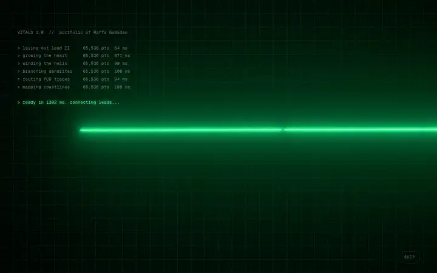
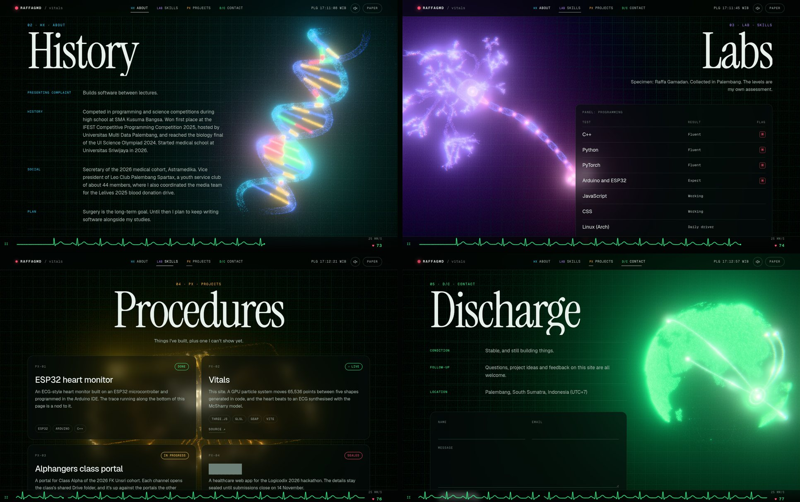
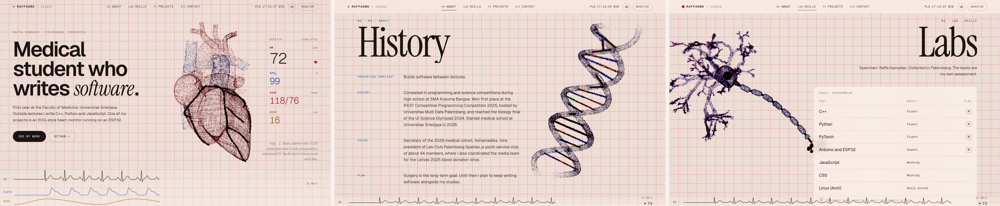
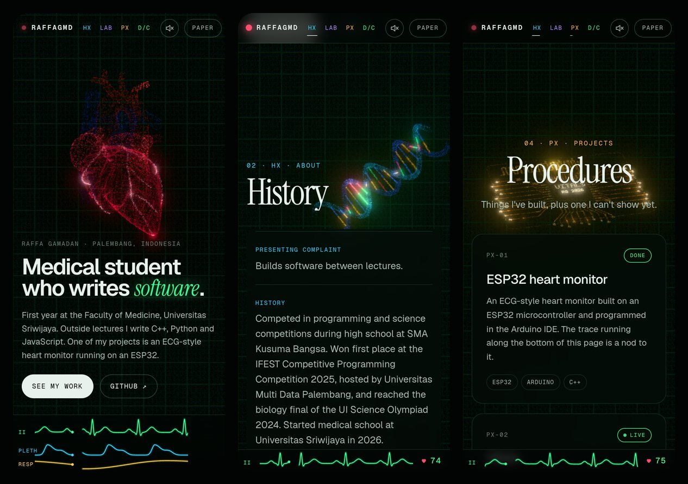

# Vitals

The portfolio site of Raffa Gamadan, a first-year medical student at Universitas Sriwijaya who writes software.

Live at **[raffagmd-vitals.netlify.app](https://raffagmd-vitals.netlify.app)**.

The page is laid out like a bedside monitor. A heart made of 65,536 particles beats in step with a simulated ECG, and as you scroll the same particles rebuild themselves into a DNA helix, a neuron, a circuit board and a globe. The site ships no 3D model files. Every shape is generated in code when the page opens.



## Things to try

- Tap the heart. It throws in a premature ventricular contraction: an early, wide beat with no P wave on the ECG, followed by a compensatory pause.
- Scroll quickly. Scroll speed counts as exercise, so the heart rate climbs, and above 100 the monitor flags sinus tachycardia.
- Turn on the sound. The beep drops in pitch as SpO2 falls, the way pulse oximeters do.
- Switch between the Monitor and Paper themes. Paper redraws everything as ink on ECG paper.
- Move the pointer through the particles, or click anywhere to push them around.

## Screenshots

Monitor theme:



Paper theme:



At phone width:



There is also a 1280 x 800 video of the intro in [docs/vitals.mp4](docs/vitals.mp4).

## How it works

### Shapes built from math

Each shape is a list of points, and every point carries a class (which sets its colour and motion) and a path value used for travelling pulses. All five are built in a Web Worker while the boot log runs.

| Shape | How it is made |
| --- | --- |
| Heart | Chambers are tapered ellipsoids joined with a smooth minimum of their signed distance functions. The ventricles are covered in short muscle fibres traced along a helical direction field, the great vessels are tubes along splines, and the coronary arteries are splines projected onto the surface. Arteries are red and veins blue, as in anatomy atlases, so the pulmonary trunk is blue. |
| DNA | B-form helix with 10.5 base pairs per turn. The backbones sit about 150° apart, which makes the major and minor grooves different widths. The 20 base pairs spell RAFFA at two bits per base (A=00, C=01, G=10, T=11). |
| Neuron | Recursive dendritic tree with spines, a soma with a nucleus, and a myelinated axon broken up by nodes of Ranvier, ending in terminal boutons. |
| Board | QFN package with a pixel-font marking, 45° fan-out traces ending in vias, castellated edges and a meander PCB antenna like the one on ESP32 modules. |
| Globe | Points on a Fibonacci lattice, kept wherever a Natural Earth land raster says there is land. Palembang is marked, and arcs run from it to six other cities. |

Points are sorted by height before upload, so point *i* sits at a similar height in every shape. Morphs then read as one flow, with far fewer particles crossing each other.

### Particles on the GPU

Positions and velocities live in two float textures that update every frame (GPGPU ping-pong through three.js's `GPUComputationRenderer`). Each particle is pulled by a spring toward a target that slides from its point in the old shape to its point in the new one. While it is in flight, a curl-noise field pushes it around. Curl noise has no divergence, so particles swirl without clumping. The pointer is treated as a ray in the particles' local space, and anything close to it gets shoved sideways and springs back.

Every particle leaves after its own delay, mixed from a hash and its index. Because the index follows height, shapes dissolve from the bottom up with some scatter. The position pass writes each particle's progress into the alpha channel, so the render pass changes its colour exactly when it moves.

### The heartbeat

The ECG is a sum of Gaussians per beat using the ECGSYN defaults from McSharry et al. (2003): P, Q, R, S and T at -70°, -15°, 0°, 15° and 100° of the cardiac cycle, with ECGSYN's heart-rate scaling of those angles and widths. Beat timing includes respiratory sinus arrhythmia and a little noise.

The particle shader runs on the same clock:

- the atria contract just after the P wave and refill while the ventricles eject;
- the ventricles start squeezing about 40 ms after the R wave, the base moves toward the apex, and the apex twists (ventricular torsion);
- a pressure wave travels up the aorta and the pulmonary trunk after ejection;
- the coronary arteries light up in diastole, which is when they fill.

In the later sections the neuron fires an action potential on every beat, and the board sends a burst of data down its traces.

### The monitor strip

Lead II, pleth and respiration are sampled into 250 Hz ring buffers and drawn in the sweep-and-erase style of real monitors. The pleth wave arrives about 0.2 s after each R wave and has a dicrotic notch. The strip is tall on the first screen and folds down to a single lead once you scroll.

### Two themes

Monitor draws the particles with additive blending, bloom, faint scanlines and grain. Paper multiplies small ink dots into ECG paper with 1 mm and 5 mm squares and skips the bloom, which ends up looking like a stippled anatomy plate. The switch is a view transition that grows out of the button. The first visit follows the system light or dark setting, and after that the site remembers the visitor's choice.

## Stack

three.js and GLSL for rendering, GSAP (ScrollTrigger, SplitText, ScrambleText) for the choreography, Lenis for smooth scrolling and Vite for the build, with no UI framework. Fonts are Geist, Geist Mono and Instrument Serif, self-hosted through Fontsource.

## Run it

```bash
npm install
npm run dev       # http://localhost:5173
npm run build     # static site in dist/
```

Node 20 or newer. `npm run land` rebuilds the land mask from Natural Earth data, which only matters if you change the globe's resolution.

## Deploy

`netlify.toml` holds the build settings, so importing the repository into Netlify works without extra setup. The contact form uses Netlify Forms. Turn on form detection in the site's Forms settings and redeploy once so Netlify registers the form.

## Project layout

```
src/
  main.js              boot, intro, scroll choreography, UI wiring
  ecg/Pacemaker.js     beat scheduling and ECG, pleth, resp synthesis
  ecg/Monitor.js       the 2D canvas strip
  gl/Experience.js     renderer, camera, post-processing, pointer ray
  gl/Simulation.js     GPGPU position and velocity passes
  gl/shapes/           heart, dna, neuron, chip, globe and flatline generators
  gl/glsl/             simulation, particle, background and final pass shaders
  styles/main.css
scripts/               land mask builder, screenshot and recording tools
```

## Performance

The page uses 65,536 particles on desktop and 20,736 on phones and low-core machines. If the first 120 frames after the intro average below about 42 fps, it lowers the pixel ratio once. The simulation falls back to half floats where full float render targets are missing. Without WebGL the particles are skipped and the rest of the page, including the monitor strip and both themes, still works.

## Credits

- ECG model: P. E. McSharry, G. D. Clifford, L. Tarassenko and L. A. Smith, "A dynamical model for generating synthetic electrocardiogram signals", IEEE Transactions on Biomedical Engineering 50(3):289-294, 2003. Parameters from the ECGSYN reference code on PhysioNet.
- Simplex noise: Ian McEwan and Stefan Gustavson (Ashima Arts), MIT licence.
- Land outlines: Natural Earth (public domain), via the world-atlas package.
- Fonts: Geist and Geist Mono by Vercel, and Instrument Serif, all under the SIL Open Font License 1.1.

## Licence

MIT. See [LICENSE](LICENSE).
